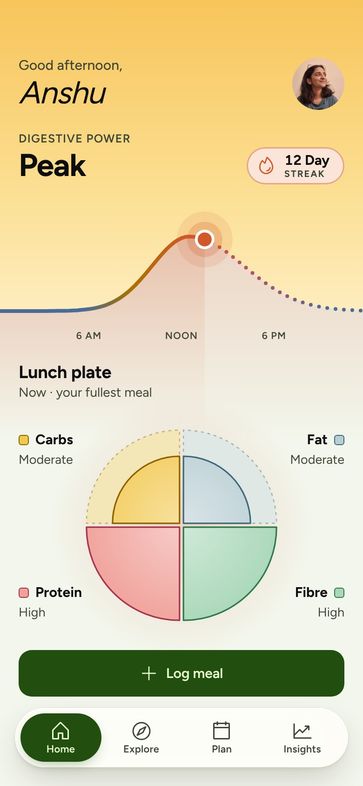
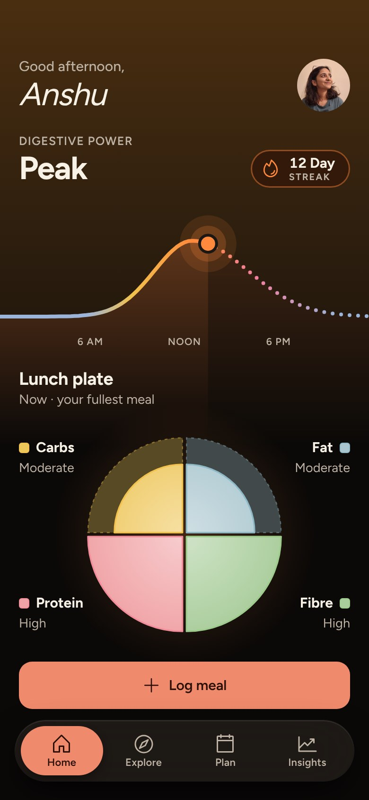

# Nutrithm · Prototype 2.0

A clickable prototype of **Nutrithm**, an Indian food app that plans your plate around your digestive rhythm instead of calories. Nutrithm = NUTRITion + circadian rhythM.

  
  

## Try it

**Live demo:** `https://<your-username>.github.io/<repo-name>/` (after you turn on GitHub Pages, below)

Or download this repo and open `index.html` in any modern browser. It needs no install, no build step and no internet.

## What's inside

- **17 screens**, in light and dark, plus a tabbed app view to start from
  - **Onboarding:** welcome, about you, food and health, your usual day, connect
  - **Home and logging:** Home, log a meal, check your meal, meal logged, level up
  - **Explore:** cook, recipe, order online
  - **Plan, Insights and Profile:** Plan, Insights, share report, profile
- **The horizon:** on Home, drag the sun along the digestive-power curve to see any hour. The sky, the agni word and the plate change with it, and let go returns it to now.
- Two buttons beside the phone: switch between light and dark mode, and **Reset** to start again from the welcome screen

## Files

| File | What it is |
|---|---|
| `index.html` | The whole prototype in one file: screens, styles, fonts, images and React, all embedded |
| `docs/` | Screenshots for this README |
| `.nojekyll` | Tells GitHub Pages to serve the files as they are |

## Publish on GitHub Pages

1. Create a new public repository on GitHub and upload these files, keeping `index.html` at the top level.
2. Go to **Settings → Pages**.
3. Under **Build and deployment**, set **Source** to *Deploy from a branch*, choose `main` and `/ (root)`, then **Save**.
4. After a minute or two, the site is live at `https://<your-username>.github.io/<repo-name>/`.

## Credits

Designed by **Raj Sonar**, Interaction Design 2025, Design Project 1.
Mentors: Dr. Mamta Rao, Jagriti Galphade and Athul Dinesh.

This is a design prototype, not medical advice. The data shown is sample data.
